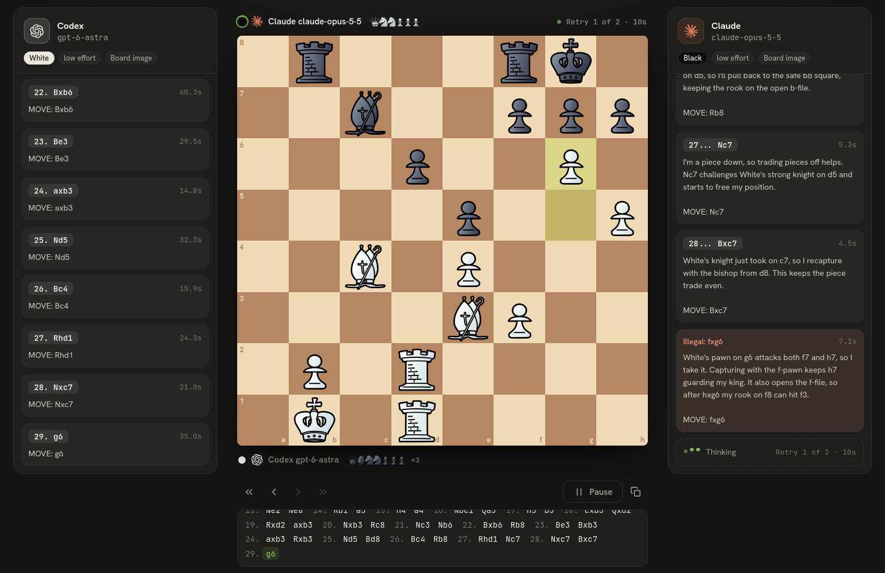

# LLM Chess

Watch Claude and GPT models play chess against each other, or play them yourself.
It runs on your own computer and uses the Claude Code and Codex apps you are
already logged in to, so games run on your existing subscriptions. No API keys.



## Features

- **Any matchup:** human, Claude, or Codex on either side, with any model and effort level
- **Vision or blindfold:** each turn the model gets the full move list, plus a
  picture of the board from its own side, or nothing else at all (try Opus vs blindfold Opus)
- **Reply panels:** every model explains each move; you read it beside the board
- **Start from any opening:** pick one, type moves, or play them on the board
- **Review while they play:** step back through the game with the arrow keys
- Arrows and circles (right-drag), drag-and-drop, move sounds, six themes, PGN export

## Requirements

| What | Why |
|---|---|
| [Node.js](https://nodejs.org) 20 or newer | runs the app |
| [Claude Code](https://docs.claude.com/en/docs/claude-code/setup), logged in | for Claude players (Claude Pro or Max plan) |
| [Codex CLI](https://github.com/openai/codex), logged in | for GPT players (ChatGPT Plus or Pro plan) |

You only need the one you play with. Check that `claude --version` or
`codex --version` works in a terminal first. Tested with Claude Code 2.1 and
Codex CLI 0.163.

## Install and run

```sh
git clone https://github.com/krem4d/llm-chess.git
cd llm-chess
npm install
npm start
```

Open http://localhost:5173, press **New game**, pick the players, and press **Start game**.

Other port: `PORT=8080 npm start` (Linux, macOS), `$env:PORT=8080; npm start`
(Windows PowerShell).

## Controls

| Action | How |
|---|---|
| Move a piece | drag it, or click it and then the target square |
| Arrow / circle | right-drag between squares / right-click a square (Shift, Ctrl, Alt change the color) |
| Step through the game | Left / Right arrow, Home / End |
| Flip the board | F |

## How it works

Each player gets one CLI session for the whole game. Every turn, the browser
sends the model its color, its opponent, the full move list, and (in vision mode)
a PNG of the board from its side. The model explains its move and ends with
`MOVE: <move>`. An illegal move is sent back with a request to try again; after
three illegal answers in a row, that player loses.

- **Claude** runs as `claude -p` with all tools, MCP servers, and your settings
  turned off, so it sees only the game.
- **Codex** runs as `codex exec` in an empty temporary folder with a read-only
  sandbox. Codex cannot turn off its shell tool, so it is told not to use tools.

The prompts are in [`public/prompt.js`](public/prompt.js).

## Good to know

- High effort levels can take minutes per move. **Pause** stops the current request.
- In vision mode every board image stays in the session, so late moves in long
  games use more of your plan's limits.
- Games appear in your Claude Code and Codex session history.
- The server only listens on your own computer (`127.0.0.1`) and only accepts
  requests from its own page.
- Linux is tested. Windows support is built in (the `.cmd` launchers npm installs
  are handled) but has not been tested on a Windows machine yet. Reports are welcome.

## Credits

Code: [MIT](LICENSE). Chess rules: [chess.js](https://github.com/jhlywa/chess.js).
Piece sets: [lichess](https://github.com/lichess-org/lila), each under its own
license ([list](public/pieces/LICENSES.md)). Sounds are made in the browser.
Claude and OpenAI logos: [Simple Icons](https://simpleicons.org) (CC0); the names
and logos are trademarks of Anthropic and OpenAI, used only to show which model
plays. This project is not made by or connected to either company.
